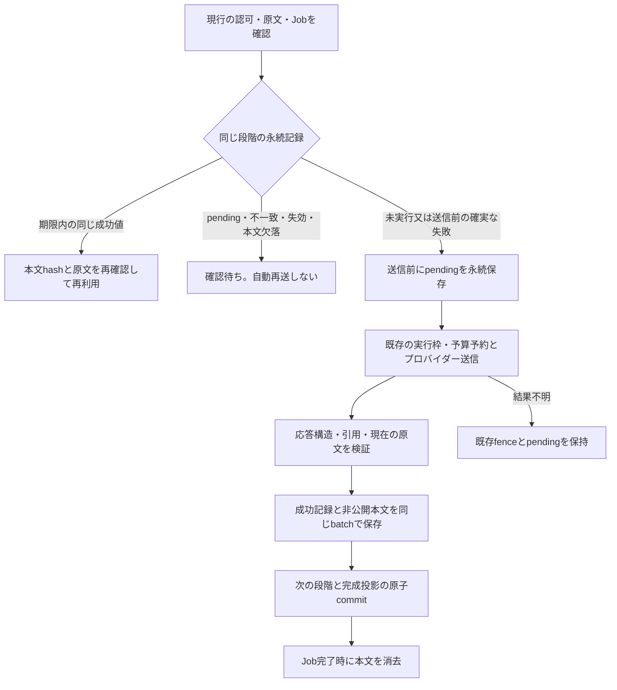

# Workerの成功AI応答の再利用

## 概要

通常のWord・Excel取込の構造化・分類・具体技能抽出について、検証済みの成功値を同じJobとその明示的再試行の範囲で再利用する。途中の依存障害、5分を超える待機、Worker再起動で成功済み推論を繰り返さない。検索・共有会話・辞書のAI候補照会へ永続キャッシュの範囲を広げない。

外部送信と保存を一つのトランザクションにはできない。送信前に永続pendingを作り、応答検証後に成功値を保存する。送信や保存の結果が不明なら保留し、完全な一度だけ実行を保証しない。

## 保存と再利用の境界

| 項目 | 方針 |
|---|---|
| 段階ID | `AiContext.PipelineStage`。構造化の原文ID、分類・技能抽出の断片IDを用い、モデルや指紋が変わっても同じ段階を別送信へ逃がさない |
| Job | 永続したprocessingのenrichment/projectionに限定。現在の集約版・利用可否・Job閲覧範囲も確認 |
| 手動再試行 | supersedesJobIdの同じ集約・版・処理種別・所有者を最大20段まで確認。新しい原文版・別Jobへ無条件に流用しない |
| 指紋 | 現在の原文snapshotと入力、プロンプト・分類体系・辞書版、モデル構成・wire request・入出力上限、tenant/principal/person・roles/scopes・AuthorityToken/AccessEpoch |
| 領域 | 既存WorkflowRecordStoreで同じ物理パーティションへ分離。共有の辞書・原本・実行予算枠へフォールバックしない |
| 再利用 | 現在の権限と原文を準備時・応答利用時に再確認。本文のhashも照合。期限内の成功値だけを返す |
| 状態不明 | pendingの期限切れや本文欠落を新しい送信枠に戻さない。AI_RESULT_REVIEW_REQUIREDとして確認待ち |

辞書版を指紋へ含めるが、保存する値は未承認の抽出値である。辞書承認や人物経験の認定は保存しない。knowledge/content_onlyは実務経験の検索語に昇格させず、技能ID対応・検索投影は従来どおり現在の辞書・原文で検証する。

## 処理順序

プロバイダー成功からHまでに停止すると、応答が得られていても再利用可能な本文がない場合がある。そこで別送信を行わず、既存の停止・結果照合・回復手順へ進む。外部サービスが要求IDによる結果照会・冪等キーを保証するものとして扱わない。

旧版のAiRunには本文がない。旧版で送信済みのJobを新実装へ持ち越した場合も、その監査だけから成功値を復元せず確認待ちにする。完了済みJobの重複Queueは従来どおり再実行しない。

## 本文の機密性と保持

成功の印は内部`aiResultReceipt`、本文は別の内部`aiResultPayload`に保存する。どちらもsystem scopeで、公開ContractKinds・AiRun・API応答・検索投影・ログに本文を追加しない。本文は最大128KiB、再利用期限はclaimから24時間。

本文だけに残り時間のitem TTLを付ける。catalogはdefaultTtl=-1とし、TTLを明示しない送信済み記録は失効させない。`/aiResult/*`を索引から除外する。Cosmosの現物メタデータがこの方針でなければ、最初のpending保存前にAI_RESULT_STORAGE_POLICY_REQUIREDとなり、送信しない。除外を上書きする具体的包含・composite/spatial indexも受け付けない。

Job完了時は本文をCASで消去し、記録をcompletedとして保持する。消去失敗はログにJob IDだけを残し、TTLと重複Queue時の再消去に任せる。完成済みJobの本文消去失敗で業務全体のfenceを閉じない。未完了の成功保存・送信結果の不明とは区別する。cleanup待機は10秒まで。

24時間を過ぎた成功値は本文がまだ物理的に残っていても再利用しない。CosmosのTTL削除は非同期で、削除処理の完了時刻やバックアップの物理消去まで24時間ちょうどと保証しない。ローカルMemory/LocalRecordStoreはCosmosのTTLエミュレーターではなく、完了時・失効値の再読時に本文を消す。

## 適用と回復

共有反映では、既存catalogのdefaultTtl=-1と本文索引除外を先に適用・再読し、その後API/Workerを配備する。新しいアカウント・コンテナ・IAMを追加しない。以前の原本、共有辞書、旧4件の重複候補・評価履歴へTTLを付けない。前提を確認せず広いfoundation再配備を繰り返さない。

AI_RESULT_REVIEW_REQUIREDでは、原文の版・現在の認可とJob、AiRunの実送信・プロバイダー要求ID、receiptの状態、本文の保存有無を読み取り照合する。通常の再試行は同じ系譜の成功値を使うが、pending・失効・不一致を解除しない。送信済み記録を削除して再送可能に戻す操作を復旧手順にしない。

既存fence/実行枠が不明状態なら、[永続化と回復](persistence.md)の停止・確認条件を満たしてから回復する。本当に新しい推論が必要な場合は、対象の新しい原文版・Jobと費用の範囲を明示して判断する。古い未使用の費用枠を別試験へ移さない。
