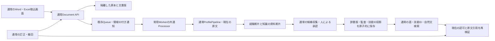

# 架空資料を使う通常処理のデモ

## 概要

以前の架空2資料を、通常の認証・取込・技能レビュー・検索・訂正・撤回で扱う。`/skill-demo.html` は永続領域を開始・再開する入口になり、固定結果を返す専用検索には切り替えない。実社員情報・実個人情報は使用しない。追加の実AI品質評価とAzure実機の確認は、オフライン試験と区別する。

## 保存先と認可

- `DemoWorkflows` は既存の `IRecordStore` に領域の状態と業務レコードを保存する。Azureでは同じCosmosのcatalog/conversations、同じBlobアカウントを使い、物理パーティションとBlob prefixだけを分ける。新しいAzureリソースやIAM権限を必要としない。
- `X-Dse-Workflow` は現在の本人・member/operator・scope・権限世代と一致する領域だけを選択する。不正なID・失効した権限から共有保存先へフォールバックしない。組織・IAM・全体運用APIはこのヘッダーでは使用できない。
- 実認可レコードをコピーしない。現在の権限を毎回照合し、通常領域と同じaccess fenceを使う。領域用の権限token/epochは導出し、別領域のカーソル・同意・未送信データを流用しない。
- サーバー再起動後も同じ権限で再開できる。1時間のTTLはない。現在は所有者本人の領域で、別利用者との共同編集・招待を許可する設計にはしていない。プロセス内サービス領域は最大8件で、それを超える場合は拒否する。既存の共有ワークスペースの認可・同意を緩めない。

## 共通の一連処理

`WorkflowRecordStore`、Blob/Queue adapterと要求内のservice provider選択以外は、通常のAPI、IdempotencyExecutor、AccessFence、SourceGuard、AI実行・予算台帳、ProfilePipeline、検索・再順位付けを共用する。予算台帳とAI実行枠は元のtenantと共通で、領域作成によって枠を増やさない。

## 原文と技能ID

開始時は次の以前の原文と保存済みの抽出を使い、AIを再送しない。原文の内容を変えずにWord原本を再構成し、ハッシュと出典付きで保存する。

- アプリ開発担当 ／ TypeScript、SQLite、Git
- 通信処理の開発担当 ／ Go、Linux、Git

6つの知識候補は人が確認し、Gitを同じID、SQLite・Linuxをそれぞれ独立したIDに対応させられる。元の重複候補4件は評価履歴として残し、承認・再収集を拒否する。履歴用原本を通常の資料一覧へ混ぜない。

知識内容は `documentFragment` として原文の版に結び付けて保存する。本人の実務経験として検索しない。承認では候補・監査・辞書版/head・投影head・SearchUnit・冪等応答を同じバッチで保存する。古い粗い `skillIds` だけの投影を、新しい技能ID一致の証明として使わない。

技能承認は原文の公開承認ではない。独立した資料検索結果は所有者だけに返し、別利用者や共有会話へ私有原文を公開しない。公開知識の利用には既存の公開承認・参加者同意の手順を使う。

通常の技能ID検索は `/api/search` に明示した辞書版と承認済みIDを渡す。自然文検索は既存の分類呼出しに閲覧可能な承認済み技能の選択を含め、追加の分類呼出しを増やさない。通常の候補上限・再順位付け・原文確認・監査を維持し、共有会話への辞書開示は広げない。

## 訂正・撤回と回復

所有者は通常の文書一覧から原本を開き、ETagと冪等キー付きで訂正版を取り込める。新しい文書版・通常ジョブ・監査を保存し、旧版を直ちに検索対象から外す。処理後に新しい原文断片を収集すると、同じ承認済み技能へ対応して新しい根拠を検索できる。

撤回は過去の原本・辞書版・候補履歴を削除せず、原文の有効版を失効させ、未完了の現行ジョブを取り消す。投影やAI応答から古い引用を復元しない。通知失敗は既存のジョブ再通知・retry APIを、同じ領域ヘッダーで使用する。共有tenantのCLI reconcileが全領域を自動探索する機能は含まない。

## 費用と確認の区別

開始・再開、保存済み抽出の収集、人による承認、語・技能ID検索、撤回は外部AIを呼ばない。Cosmos/Blob/Queue、API/Worker、プレビューの既存運用費は発生し得る。新規取込・訂正・自然文検索・AI候補照会は、環境に設定されたAIと既存の停止・台帳・同意確認に従う。失敗時の通常Worker再試行もあるため、実AI試験は対象の文書・現在の断片・試行設定から上限を確認して別途承認する。

ローカルでは実AIサービスと同じcodec・実行ガードを、HTTP送信を持たないtransportでも検証する。これは実モデルの意味品質やAzure Queue/常用Workerの実機成功を証明しない。旧メモリデモAPIと読み取り専用の辞書専用検索APIは比較用に残るが、新しい入口では使わない。

契約は [永続デモと文書ライフサイクル](specs/openapi-durable-workflow-v1.json)、[通常自然文検索](specs/openapi-search-v2.json)、[保存レコード](specs/contracts.schema.json)。実行記録は [今回の調査と方針](validation-results/20261108-durable-skill-workflow-plan.md) を参照する。
