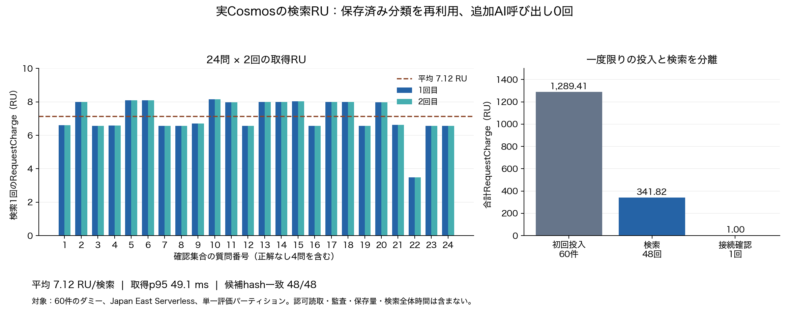

# 実Cosmosの検索用投影RU測定

2026-10-03。Issue #14 / PR #29。承認済みevaluation-v2と保存済みJEV分類を再利用し、追加AI呼出し0回で実Cosmosの検索用投影を測定した。本番設定の採用判定は行っていない。

## 結果

| 項目 | 実測 / 推計 |
| --- | ---: |
| 確認質問 / 検索回数 | 24問 × 2回 = 48回 |
| 投入したダミー投影 | 60件 |
| 検索1回の平均RU | 7.1212 RU |
| 検索1回の最小 / 最大RU | 3.49 / 8.15 RU |
| 全検索RU | 341.818 RU |
| 初回データ投入RU | 1,289.410 RU |
| 接続確認RU | 1 RU |
| 今回記録した合計RU | 1,632.228 RU |
| 取得時間の平均 / p95 | 46.52 / 49.14 ms |
| 保存済み一次候補とのhash一致 | 48 / 48 |
| 追加JEV / LLM呼出し | 0 / 0 |
| 月100検索の取得RU推計 | 712.121 RU/月 |
| 月100検索の取得RU料金推計 | 約0.032円/月 |
| 今回の記録RU料金推計（投入含む） | 約0.073円 |



[SVG](cosmos-ru.svg) / [PDF](cosmos-ru.pdf)。左の質問番号は[CSV](queries.csv)の出現順。正解なし4問も含む。データ投入は一度限りの処理として、月額の検索費用へ混ぜていない。

## 条件と測定範囲

- 既存 `dse-cosmos-ypbunss3xh66m`、Japan East、Serverless、ゾーン冗長なし、整合性Session。
- DB `dse-growth-loop` / `catalog`、`/tenantId`を指定する単一の隔離評価パーティション。60件は今回生成した専用tenantIdへCreateのみで投入し、既存レコードを上書きしていない。ダミー投影は検証証跡として残している。
- 確認集合の正解あり20問＋正解なし4問。固定E（文書閾値0.3 / 質問Top-1 / Noul0.3 / N=20）。原本とJEV応答は先行評価から再利用した。
- 既存 `CosmosCatalog.BuildQuery` のSQLに、評価と同じ人物/事例の `entityType` 条件を追加。各応答ページのSDK `RequestCharge` を全て加算。MaxItemCount=100、全48検索は各1ページ。
- 取得後の候補順位は既存評価と同じLegacy Retriever。比較時だけtenantIdを元の `demo-tenant` に戻し、候補・根拠・分類等を含むhashが一致することを確認した。保存済みLuna6応答の候補集合を再現できる。本番retrieval-v2の評価とは異なる。
- 索引はconsistent / automatic、`/*`を含み、`/summary/?`、`/sourceRefs/*`、`/_etag/?`を除外。詳細は[測定時設定](container-settings.json)。索引設定を変更していない。
- 取得時間はSDKのページ取得から計測し、ページ証跡のローカル保存時間を含む。AI・原本認可読取・フェンス・監査・UIを含まない。接続確認・投入で接続が確立した後の検索であり、アプリ冷起動の計測ではない。48標本のp95はnearest-rank。第1周p95=60.95ms、第2周p95=46.95ms。
- 5,000 RUを観測後の停止閾値とし、429自動再試行を無効化。正常48検索を追加で再送していない。この閾値はサービス側の厳密な請求上限ではない。

今回のRUは検索用投影の取得分である。原本・根拠の認可読取、アクセスフェンス、検索監査、AI台帳、索引/データ保存量、バックアップ、転送、他Azureサービスを含む検索全体・Azure全体の料金とは扱わない。ウォーム検索全体の15秒ゲートにも流用しない。

## 費用の前提

検証用途として月100検索（約3回/日）を仮定した。実利用数ではない。Microsoft Retail Prices APIで2026-10-03に取得したJapan East / JPY / `Azure Cosmos DB serverless` / `1M RUs` / 単位`1M`の公開単価は **44.9017円/100万RU**。有効開始日は2023-04-01。ゾーン倍率なし。

`月額取得RU料金 = 7.1212083333 × 100 × 44.9017 / 1,000,000 = 0.031975436円`。

[取得単価・公式API URL](retail-price.json) / [Serverless公式料金説明](https://azure.microsoft.com/en-us/pricing/details/cosmos-db/serverless/)。JPY公開単価を直接使用し、独自の為替換算は行っていない。税・契約割引・請求の丸め・実請求は未照合。保存量を含む合計月額と承認済み8,000円予算の最終判定は未完了。

## 権限と証跡

最初の読取はHTTP 403 / substatus 5301、記録RequestCharge=0。ユーザーが一時付与・検証後の解除を明示承認し、現在のログインにcatalog限定のCosmos DB Built-in Data Contributorを付与した。測定後に今回のrole assignmentを削除し、再一覧が空であることを確認した。既存MIの権限は変更していない。[権限証跡](access-control.json) / [初回失敗](initial-probe-status.json)。キーを取得・使用していない。

- [送信前計画](plan.json)：入力hash、隔離tenant、件数、条件、範囲。
- [全ページ/投入の生ログ](operations.jsonl)：測定1読取＋60Create＋48ページ。
- [検索JSON](queries.json) / [CSV](queries.csv)：RU、取得時間、ページ数、候補hash。
- [集計](summary.json) / [完了状態](status.json) / [ファイルhash](manifest.json)。

## 再現と確認

課金も認証も不要な確認：

```sh
dotnet run --project src/Dse.CosmosEvaluation -- --prepare .artifacts/cosmos-replay-new
python3 scripts/plot_cosmos_evaluation.py --out .artifacts/cosmos-figures-new
```

`--prepare`は保存済みJEV応答を復元し、24問全てのローカル候補hashを先行評価と照合する。既存出力の上書きを禁止する。

実サービスの再計測は、データ権限と別途実行承認がある環境で `--probe` または `--run` を明示する。`--run`は新しい隔離tenantへ60件をCreateし48検索を行う。通常のアプリ起動・CIから有料処理を呼ばない。今回の一時権限は解除済み。

測定CLIのビルド（警告・エラー0）、ロック済みrestore、ローカル24候補hash照合、48実検索のhash照合、JSON/CSVとRU集計の一致、図の表示を確認した。.NET回帰結果は検証証跡のmanifestに記録する。

## Issue Todo照合

元Todoの「実Cosmosのページ別RequestCharge・索引/保存量、全AIトークン、冷/温p50/p95、費用を同じrunIdで記録」は複合項目。この試験では投影ページRUと索引設定を実測したが、索引/保存量の分離、AIを含む統合run、検索全体のcold/warm等が残るためチェックしない。採用設定・全Azure月額の項目も未完了。元Todoは4/12、Issueはopen、PR #29へ結果を追加する。
