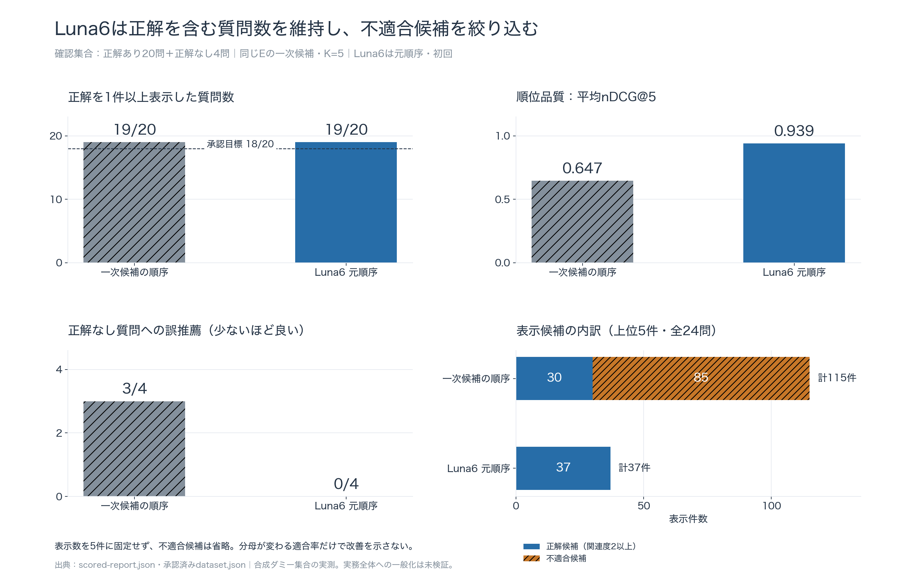
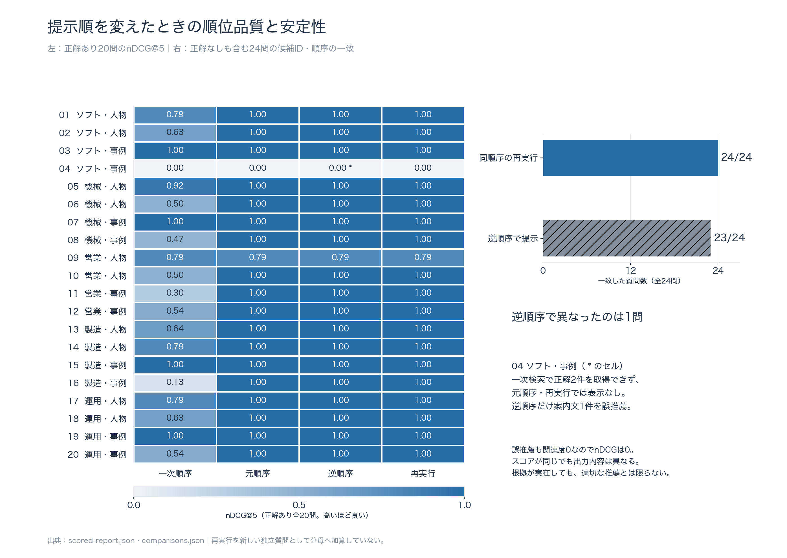
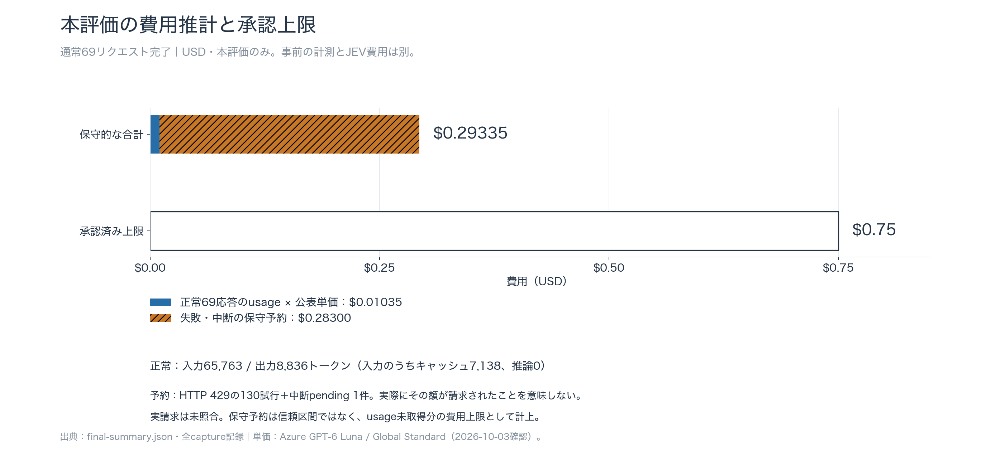

# Luna6評価結果をグラフで見る

2026-10-03。承認済みの架空確認集合（正解あり20問＋正解なし4問）を使用した実評価。参照条件は、実JEV＋Noul＋語一致で取得したEの一次候補を取得順に表示する結果。同じ候補をLuna6で絞り込み・再順位付けした結果と比較する。以下の3枚をPNG・SVG・PDFで保存した。

## 1. 正解の拾い方と不要候補の除外



正解を1件以上表示した質問は19/20を維持し、正解なしへの誤推薦は3/4から0/4へ減少した。順位品質のnDCG@5は、関連度の高い正解を理想の順序で並べた場合を1とする指標で、平均0.647から0.939に改善した。

右下は全24問の上位5件で実際に表示した候補数を集計。正解候補は30件から37件へ、不適合候補は85件から0件へ変化した。同じ候補が異なる質問で表示された場合は、質問ごとの推薦としてそれぞれ数える。空出力によって分母が変わるため、適合率だけを比べず、件数・質問単位の成功・順位品質を併記した。

[PNG](charts/01-quality-overview.png) · [SVG](charts/01-quality-overview.svg) · [PDF](charts/01-quality-overview.pdf)

## 2. 質問別の順位品質と提示順の影響



ヒートマップは正解あり全20問のnDCG@5。正解ありで空出力になった質問も0として含める。同順序の再実行は24/24問で候補ID・順序が一致、逆順提示は23/24問で一致した。右の安定性には正解なし4問も含む。

`04 ソフト・事例` は一次検索で正解を取得できなかった質問。元順序・再実行は空出力だが、逆順序だけ案内文1件を誤推薦した。どちらも正解を表示できずnDCG=0なので、同じスコアでも出力内容が異なることを注記した。再実行を新しい独立質問として分母へ足していない。

[PNG](charts/02-question-quality-and-stability.png) · [SVG](charts/02-question-quality-and-stability.svg) · [PDF](charts/02-question-quality-and-stability.pdf)

## 3. 費用推計と承認予算



正常69応答のusageから算出した費用推計は$0.01035188。130回のHTTP429と中断pending 1件の保守予約$0.283を加えた$0.29335188は、承認上限$0.75内。保守予約は実請求や統計的な信頼区間を意味しない。本評価の費用だけを表示し、事前計測・JEV・想定月額は合算していない。

[PNG](charts/03-cost-and-budget.png) · [SVG](charts/03-cost-and-budget.svg) · [PDF](charts/03-cost-and-budget.pdf)

## 出典・再生成・表示確認

[詳細な実測結果](results.md)、[採点レポート](scored-report.json)、[費用・安定性サマリー](final-summary.json)、[承認済みラベル](../../../evaluation/expansion-v2/dataset.json)を使用した。[図の数値](charts/chart-data.json)と[入力・画像hash、使用版](charts/manifest.json)を保存している。JSON構文の成功率と推薦の意味的な適切さ、LLM単体時間と検索全体SLOは別の評価であり、図から未測定項目の合格を示さない。

リポジトリルートから、追加AI呼出し・課金なしで再生成できる。

```sh
python3 scripts/plot_luna6_evaluation.py
```

使用環境はMatplotlib 3.10.0、日本語フォントHiragino Sans。別環境ではNoto Sans CJK JPまたはIPAexGothicを利用でき、`--font /path/to/font.ttf` で指定する。`--out .artifacts/luna6-charts` で別の出力先に生成できる。

元データから質問数・表示候補の正解/不適合件数・費用合算を照合した。全PNGと、PDFをmacOSの`sips`で画像化した全3ページを目視し、日本語の欠落・ラベルの重なり・切れを確認して修正した。総合比較のグレースケール表示でも、ハッチと数値による区別を確認した。SVGは日本語をパス化して出力し、元データ・図の数値・出力hashを検証した。
