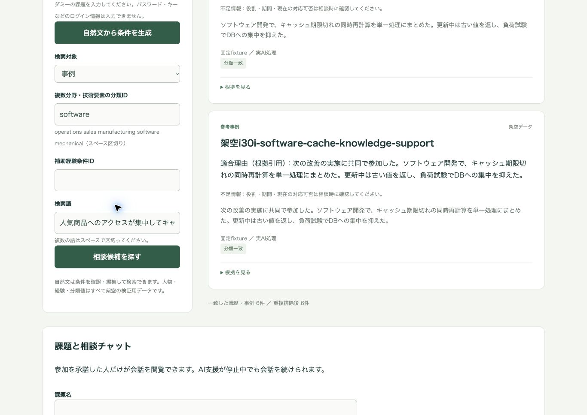
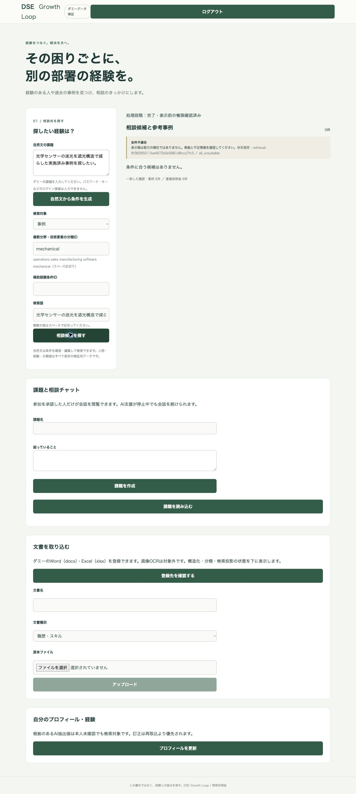

# Issue 30 改修後の本番・実AI回帰検証

2026-10-03、改修済みAPIを本番へ一時展開し、実Cosmos／Jev／Foundryで検証した。**人物・事例を明示指定する検索は回帰品質基準に合格した。** 入力上限超過と正解なし誤推薦は解消した。ただし人物の正解1件の一次取得漏れと、既定の混在検索における事例精度の不足は残る。検証後は元イメージ・設定・公開範囲・AI停止・稼働0へ復帰済み。新イメージの恒久採用は行っていない。

## 条件と測定範囲

前回の独立検証で既に観測した合成24問（人物正解あり10、事例正解あり10、正解なし4）をラベル・原資料・投影を変更せず再使用した。未観測の独立集合ではなく回帰集合である。`all`と対象種別指定の2条件、計48検索を本番サービスJobで実行した。承認済み専用公開範囲だけを一時使用し、JWT・許可ユーザーを維持した。

人物上限10／事例15／救済2、`search-rerank-v2`、`search-total-bytes-v1`、入力上界16,000を固定。Jevは`jev-1.13.0`、Foundryは`dse-luna6-eval`（`gpt-6-luna-2026-09-22`、版2026-09-22）。試行1・並列1。ソースhashと計画をAI実行前に固定した。[実行計画](execution-plan.json)、[実行・全応答と監査](production-report.json)、[再採点結果](summary.json)、[AI来歴](ai-provenance.json)を参照。

## 最終推薦の品質

先頭5件の指標は、対象種別だけに絞った仮想表示ではなく、実際に返す推薦IDを分母に採点した。各種別の正解あり10問が分母。Precisionは各問の表示候補中の正解割合の平均、Hitは正解を1件以上表示した問の割合、Recallは各問の正解全体に対する取得割合の平均である。

| 指標 | 前回の本番サービス・混在 | 今回の対象種別指定 |
|---|---:|---:|
| 人物・一次Recall | 90% | 95% |
| 事例・一次Recall | 100% | 100% |
| 人物・最終Hit@5 | 100% | 100% |
| 事例・最終Hit@5 | 20% | 100% |
| 人物・最終Precision@5 | 35% | 100% |
| 事例・最終Precision@5 | 10% | 100% |
| 正解なしの誤推薦 | 2/4問 | 0/4問 |
| リランク入力上限超過 | 16/24問 | 0/24問 |

今回の種別指定では正解あり20問すべてリランク成功、他種別推薦0問。人物の最終Recall@5は95%、事例100%。`i30i-sales-discount-person-query`の共同実施者`i30i-sales-discount-person-support`は一次取得時点で漏れており、リランクで復元できなかった。

正解なし4問中2問は実LLMが全件不適合と判定し、2問はJev分類unknownによる手動移行で推薦を停止した。後者をLLMの正解なし判定成功とは数えない。

**既定の`all`条件では事例Precision@5が53.3%、他種別混在が10問残る。** 人物Precisionと両種別Hitは100%、正解なし誤推薦は0/4だったが、混在条件は種別精度の基準を満たさない。今回の合格は明示的な対象種別指定に限る。UI/APIの既定値は引き続き`all`である。前回比には入力量管理・失敗時抑止・種別指定の複合効果が含まれ、個々の改修の因果効果を切り分けた実験ではない。

## 実AI・入力・使用量

48検索に対し実AI呼出し68回（Jev24、Foundryリランク44）、質問分類キャッシュ24件。リランクのキャッシュ再利用は0件、再試行・監査上のAI失敗0件。実リクエストの保守的な入力byte上界は最大13,084で上限内、根拠本文の追加切詰めは0byteだった。

検索Job分の使用量は入力106,179／出力20,256トークン、推計AI費用3.5549688円（計画為替200円/USD）、検索RU 12,637.91。実請求ではなく、代表HTTP4問・インフラ・監査取得・Blob操作費用は含まない。台帳の呼出し数はJob前132→後200、予約中0・停止理由なし。日次上限240回／450万トークン／推計200円を維持した。

サービス内p95は混在16.14秒、種別指定10.01秒。後半の種別指定は質問分類キャッシュを再利用しており、差を種別指定だけの速度改善とは扱わない。公開HTTPのp95・冷起動SLOは今回未測定。

## 本番HTTP／JWT・画面確認

既存MSAL JWTを使う通常の本番SPAで代表4問を確認した。正解あり人物・事例は各2件の正解だけを推薦、正解なし人物・事例は各0件だった。別途AI停止時には一次候補があっても表示0件となり、「候補の評価を完了できませんでした」を表示した。未評価候補を推薦として表示しないことを確認した。

全24問のHTTP品質評価ではなく代表4問の疎通・表示確認であり、HTTP時間は測定していない。[検索ID・期待結果との照合](http-smoke.json)を参照。

## 展開と復帰

API `dse-api:issue30-hardening1`と評価Runnerを既存ACRへ登録し、一時展開した。回帰Job `dse-validation-issue30-x0a2coa`、読み取り専用エクスポートJob `dse-validation-issue30-b16y4ye`は成功。エクスポート38分割を再構成し、gzip展開後931,912byteのSHA256を照合した。[エクスポート証跡](export-provenance.json)。通常Worker・RBACは変更していない。

元API `dse-api:issue9-final5`、全環境変数、公開範囲`demo`、認証・identity・scaleを復帰した。API各対象revisionの実replica数0、API/Workerのactive revisionなし、実行中Jobなしを確認。検証Jobはopt-in false・AI停止・予算0。16項目すべて一致し、2026-10-03 12:03:16 UTCに確認済み。[復帰結果](restoration.json)。新イメージはACRに保持した。

## 再現と残る確認

`python3 scripts/issue30_hardening_production_report.py`で固定ソースhash・24問×2条件の完了を検査し再採点できる。採点・輸送復元の関連テスト8件が成功した。今回のRunnerはDockerビルドと実Job実行で確認した。コア改修のローカル検証は[別記録](../20261003-issue-30-search-hardening/results.md)を参照し、fixture結果を実AI品質に混ぜない。

次の品質確認は未観測・人手承認済み集合で行う必要がある。一次取得漏れと混在時の対象意図、全問の公開HTTP品質・冷起動時間、恒久採用は未解決または未実施である。
