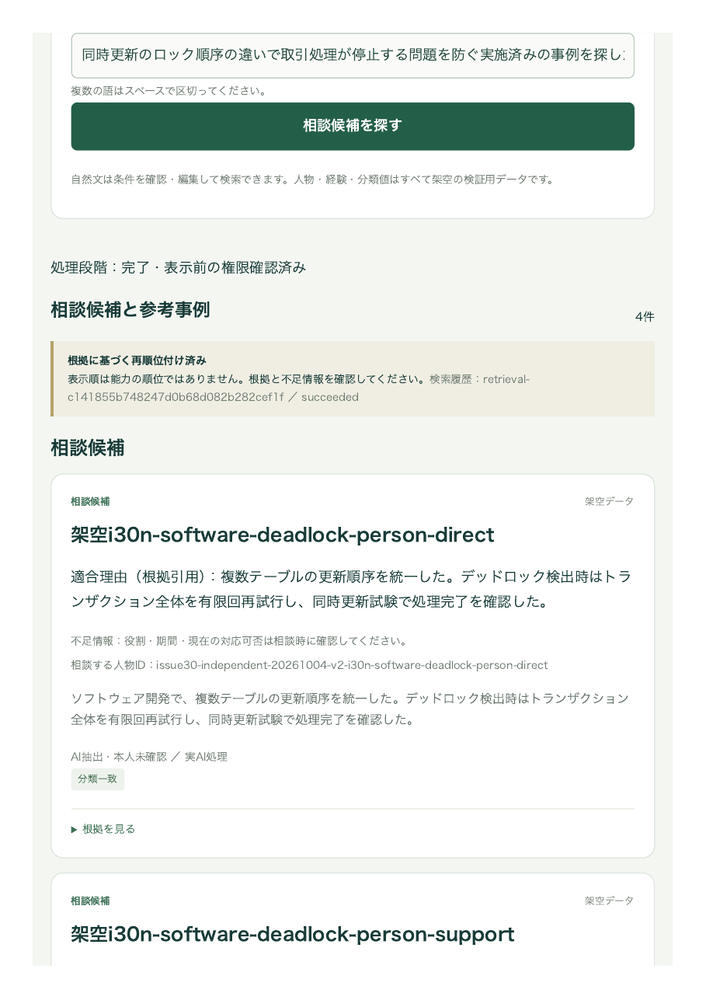

# Issue #30 新規独立集合の本番検証

検証日：2026-10-03〜04 UTC。新規24問・60原本のラベルと実行費用は[今回のユーザー承認](../../../evaluation/issue-30/independent-v2/execution-approval.json)を使用した。人物15／事例15／救済2、既存Jev 1.13.0・Foundry Luna6・プロンプトを固定し、結果を見て集合や検索条件を調整していない。元の24問とは質問・原文の完全一致0。[変更候補8問の回帰](../20261004-issue-30-person-rerank-live/results.md)とは別の評価である。

**品質ゲートは不合格。恒久採用とIssue #30完了は保留する。** 人物候補枠を増やしても、質問分類と語の一次取得経路に取得漏れが残った。初回の分類スキーマ不一致も失敗として保持する。再検索24問は共有日次上限の残量不足により未実施。

## サービス経路：24問×全対象・対象指定

既存Azure Cosmos／Blob／Managed Identityと通常の分類・取得・再順位付けを使用した。独立評価用のダミー主体は検証Runner内だけに存在する。[保存応答](production-report.json)、[再採点](service-summary.json)、[チェックサム付き取得記録](export-provenance.json)を参照。各種別の正解あり10問を分母とする。正解は各問2件。Precisionは空結果を0として、実表示上位最大5件の正解率を質問ごとに平均した。

| 条件・種別 | 一次Recall | 種別欄Hit@5 | 種別欄Precision@5 | 種別欄Recall@5 |
|---|---:|---:|---:|---:|
| 全対象・人物 | 90% | 90% | 90% | 90% |
| 全対象・事例 | 85% | 90% | 90% | 85% |
| 対象指定・人物 | 90% | 90% | 90% | 90% |
| 対象指定・事例 | 95% | 100% | 100% | 95% |

正解なし誤推薦は両条件0/4、対象指定の他種別混入0。引用理由の原文一致は全対象51/51、対象指定39/39。全対象の事例を混在先頭5件で採点したPrecisionは50%、種別欄では90%。表示改善とAI判断の改善を区別する。

### 残った取得漏れと失敗

- `i30n-sales-tender-person-query`：両条件で人物の正解2件を一次取得できず、複数職歴・副業務の正解も失う。質問分類は`operations`、正規化語は質問全文1語。正解は上限適用前の`mergedIds`にも存在せず、人物15の打切り損失ではない。Probability／Noul／語のどの経路にも人物正解が入らず、救済枠では戻せない。
- `i30n-sales-tender-knowledge-query`：直接事例の正解1件を上限前に失う。共同実施の事例は取得・表示できた。
- 全対象の`i30n-sales-renewal-knowledge-query`：通常分類が`SchemaMismatch`となり、取得前に手動編集を要求した。初回の一次Recall・最終品質は0として評価する。その後のHTTP成功で初回を置き換えない。
- 正解なし03／04はサービス側の通常分類が成功した`unknown`／`other`による手動編集案内。正解ありの失敗や予算停止とは別に記録した。

取得できた正解が候補上限によって落ちた件数は0。欠落した入札正解について、語の分解・分類の扱いを改修する必要がある。ただしこの集合は観測済みになったため、次の修正では回帰用とし、品質判定には別の新規人手承認済み集合を用いる。

## JWT付きの本番画面：初回24問×2条件

一時APIに既存Entra認証のSPAから検索した。自然文を変更するたび自動分類から開始し、手動条件を注入していない。全対象は人物・事例の別欄、対象指定は指定欄だけを確認した。[画面観察](ui-initial-observations.json)、[秘密・ヘッダーを除外したHTTP応答](http-initial.json)、[画面経路の集計](http-summary.json)を参照。入力は承認済みダミー質問のみ。[画面のPDF証跡](grouped-ui-proof.pdf)は、事例のコールド検索で両欄が表示された後にChromeから出力した。画像ファイル保存のプレビュー操作は、無関係のダウンロード情報を露出するとの自動承認レビューで拒否されたため実施していない。

| 条件・種別 | 種別欄Hit@5 | 種別欄Precision@5 | 種別欄Recall@5 |
|---|---:|---:|---:|
| 全対象・人物 | 90% | 90% | 90% |
| 全対象・事例 | 100% | 100% | 95% |
| 対象指定・人物 | 90% | 90% | 90% |
| 対象指定・事例 | 90% | 90% | 85% |

入札の人物取得漏れが両条件で再現した。対象指定の腐食事例は分類スキーマ不一致で手動編集案内になった。正解なしの他3問を含め、画面上の失敗は全対象3／対象指定3件。正解なし誤推薦は0/4、対象外の推薦0、表示理由の原文一致90/90。

ChromeのNetworkログは48要求を示したが、sanitized HARには成功42件しか出力されなかった。失敗6件は画面観察として保持し、HTTPステータス・通信時間を補作していない。`primary.candidates`は最終の表示候補なので、HTTP応答だけから上限適用前Recall／救済を再計算しない。サービス監査の一次Recallとは区別する。

### 応答時間

| 初回の成功応答 | 件数 | 中央値 | p95 | 最大 |
|---|---:|---:|---:|---:|
| 全対象 | 21 | 11.14秒 | 17.69秒 | 49.40秒 |
| 対象指定 | 21 | 7.16秒 | 11.40秒 | 12.85秒 |

HARの検索POSTから応答完了までの時間。p95は線形補間。失敗6件の通信時間は未取得のため除外した。画面の完了観測はポーリングを含む上界であり、最初の2件には観測時間がない。正確な描画時間、warm全24問のSLO、全失敗を含む可用性SLOの達成は主張しない。

### 実レプリカ0からのコールド検索

[通信記録](http-cold.json)と[画面・前提の観察](ui-cold-observations.json)を保存した。検索直前のAzure CLIで毎回実レプリカ0を確認し、保持したSPAを再読み込みせず検索POSTで0→1を起動した。既存のmin0／max1と待機設定を維持した。

| 代表質問（全対象） | HTTP応答完了 | 画面完了観測の上界 | 結果 |
|---|---:|---:|---|
| 人物・デッドロック対策 | 54.60秒 | 54.70秒 | 正解人物2件表示 |
| 事例・デッドロック対策 | 49.06秒 | 49.17秒 | 人物2件・事例2件表示 |
| 正解なし01 | 45.35秒 | 45.43秒 | 両欄推薦0件 |

3件の観測値であり、cold全質問のp95やSLO達成を意味しない。

共有UTC日次利用量を再検索前に確認したところ196/240回、予約0件だった。[台帳・監査スナップショット](ledger-before-warm.json)。再検索24問の最大48回を加えると244回になるため、一式を実行せず日次リセット後に残した。上限を引き上げたり失敗質問を手動分類で迂回したりしていない。

画面PDFの結果欄（印刷ページ2、ブラウザの画素キャプチャとは別の証跡）：

## 投入・回復と測定の限界

最初のseedは共有日次上限で28件目の分類前に停止した。モデル送信済み32回、未送信停止の試行0、予約0。次UTC日に、既存正本・証跡・有効版・SourceGuardを照合し、完成済み27件を送信せず再利用した。未送信だった1件と残りを進め、60原本を完成させた。seed合計70実送信、論理分類100処理中30件は通常キャッシュ。

初期の回復Runnerが検索投影を正本Repositoryから読もうとして停止した2回は、新規AI送信なし。投影専用のRecordStore読取へ修正した。新規質問を送信する前に分類の観測ラッパーと取得監査の保存を追加した。さらに初回HTTP後、`--ledger-status`の読み取り専用出力を追加した。モデル・プロンプト・取得・質問は変更していないが、Runner全体を最初から完全に無変更だったとは扱わない。保存した段階別manifestを参照。

## 費用・復帰・残作業

承認上限は独立AI300円、変更候補回帰AI10円、追加インフラ100円。推定AI費用はトークン実測と単価・為替200円/USDによる計算であり、請求書との照合は別途必要。[費用・使用量](cost-summary.json)、[最終台帳のチェックサム付き取得](ledger-final-provenance.json)を保存した。独立評価は実送信234回、入力295,192／出力51,499トークン、推定AI **8.0019176円**。変更候補回帰24回は別に0.867488円、合計推定AI8.8694056円。初回未送信の予算停止1件、分類スキーマ不一致3件を監査に保持し、入力／出力上限超過0件。通常キャッシュ53件を含む。

最終共有日次台帳は202/240回、319,459トークン、推定7.7958488円、予約0件。昨日の独立seed分32回と0.2060688円を加えた上記独立費用と、共有日次台帳の範囲は異なる。

追加計算資源は保守上界33.43円。APIは前後作業を含む77分の窓に、復帰中の最大2リビジョンが全時間稼働したと仮定して154レプリカ分（承認累計4時間内）で上界計算した。Jobは[21実行の開始・終了](job-runtime.json)を使用し、終了時刻のない失敗3件をそれぞれ設定済みtimeout900秒として計3,809秒（承認累計2時間内）で上界計算した。実請求額ではない。Storage／Cosmos RU／Log／ACRを含む追加インフラ総額と100円上限の請求照合は未完了。

[最終復帰確認](restoration.json)：APIとWorkerの元イメージ・全環境変数・スケール設定一致、APIの全リビジョン停止・実レプリカ0、Workerのレプリカ0。検証Jobの元テンプレート完全一致・実行中0件。公開範囲・認証・AI停止・予算0を元に戻した。新規RBAC／恒久設定変更はない。

[今回のローカル検証](checks.json)：.NET全353件、Pythonスクリプト91件成功、ソリューション／React型検査・Viteビルド成功、リンク／JSON／空白検査成功。既存ASPIRE010警告1件。検索E2E12件は同じUI改修時の[先行ローカル記録](../20261004-issue-30-person-limits/checks.json)であり、今回のライブ測定後の再実行とは扱わない。

その後、ユーザーがAI・検証インフラ合計の週次上限2,000円、固定為替162円/USDを承認した。[週次制御・移行記録](weekly-budget.md)により日次リセット待ちは解除した。残り24問は台帳移行と事前確認を通過したが、MacロックによるHTTP計時ログ保存の停止で、送信前にAPIを元の停止設定へ戻した。解除連絡後に同じ24問の計時反復を完了した。詳細は後記を参照。未達品質の修正と新たな独立評価、恒久採用の判断も残る。現在の独立集合を再調整用の未観測集合として再利用しない。

予算変更前の200円/USDの使用量記録は元の証跡として保持する。[162円/USDでの再換算と当週の引継ぎ](weekly-cost-reconciliation.json)を別に追加した。予算変更後の新規推論は46回で、原文・ラベル・検索設定・モデル・単価は変更していない。

## warm24問の再開結果（2026-10-04 13時台・日本時間）

Mac解除後に通常のChrome操作を実確認し、起動済みAPIと通常JWTから同じ24問を各1回、`target=all` で送信した。リクエストに手動条件を渡していない。新しいイメージの変更は週次予算台帳と為替のみで、取得・分類・再順位付け・ラベル・原文は変更していない。初回の独立評価を再送結果で置き換えない。

| 項目 | 実測／判定 |
|---|---|
| UI観測 | 24問。22問は結果表示、正解なし03/04は手動条件を要求して検索失敗 |
| HTTP応答時間 | 成功22問。中央値11.612秒、p95 18.622秒、最大18.975秒 |
| warm p95 15秒基準 | **未達** |
| 人物：種別欄Hit／Precision／Recall | 90%／90%／90% |
| 事例：種別欄Hit／Precision／Recall | 100%／100%／95% |
| 事例：混在先頭5件Precision | 55%（混在のまま再採点した参考値） |
| 正解なし誤推薦 | 0/4。手動条件待ちを推薦成功とは数えない |
| 根拠ID・引用 | 表示55件の55件が承認済み原文と一致。意味的な説明品質の独立評価ではない |

失敗2問はHARに含まれず、HTTP status・時間は未取得のまま残した。24問全体の可用性SLO達成は主張しない。画面の完了時間は観測処理を含む上界であり、HTTP応答時間とは区別する。入札対応の人物は候補0、事例は共同実施1件のみで、元の検索漏れが再現した。今回のモデル監査には新たなschema不一致・追加試行・上限超過はない。

[HTTP応答](http-warm.json)、[UI観測](ui-warm-observations.json)、[集計](http-warm-summary.json)、[監査・週次台帳](ledger-weekly-postwarm.json)、[チェックサム付き取得記録](ledger-weekly-postwarm-provenance.json)を保存した。UI最終状態は[ブラウザー印刷PDF](warm-ui-failure-proof.pdf)と[その2ページ目のレンダリング](warm-ui-failure-proof-page2.png)に保存した。印刷用レイアウトであり、画面そのもののピクセル計測には使わない。

再現：`python3 scripts/issue30_http_report.py`（保存された応答・観測の集計のみ。追加推論なし）。新規46call、入力79,171／出力13,591token、推定AI1.902684492円。独立評価全体280callは固定上限362内。独立AIの162円換算は8.384237748円、変更候補回帰は0.70266528円で合計9.086903028円。当週全体の永続予約は519call・実行時AI14.907390012円。留保1,200円を含め1,214.907390012円で週次2,000円内。予約0件、日次412,221tokenで450万token内。

[費用・累計時間](cost-weekly-final.json)ではAPI最大208レプリカ分、Job最大66分40秒で、累計4時間／2時間を維持した。計算資源費の上界は35.1864円（固定162円/USD）。Storage・Cosmos・Log・ACR等の実請求は未照合で、全インフラ実請求とは扱わない。[復帰確認](warm-restoration.json)では元API/Jobのイメージ・環境変数・scaleに一致し、APIのアクティブリビジョン／実レプリカ、実行中Job、AI予約は0。Workerは元の停止状態を維持した。

残課題は入札対応の分類・一次取得漏れ、初回評価の分類schema不一致、ウォーム応答時間の改善と、新たに承認・凍結した未観測集合での再確認。今回の独立集合を未観測集合として再利用しない。品質・時間基準が未達のためIssue #30の完了と恒久採用は保留する。

最終検証：全.NETテスト361件、Pythonテスト94件（集計・Bicep検証を含む）が成功。保存JSON・リンク・チェックサム・`git diff --check`を確認。
