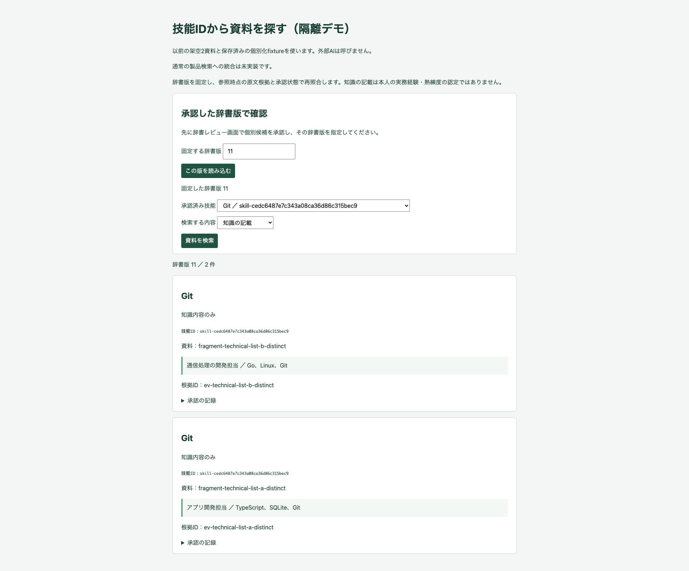

# 技能辞書承認から資料検索までの隔離デモ

## 概要

今回の開発は終始、実データを使わず、以前の架空資料でどこまでできるかを示すデモである。以前の2資料と個別化した保存応答fixtureを使い、辞書承認・ID対応・原文根拠付きの資料検索をlocalhostのMemoryRecordStore内で検証した。通常の製品検索に技能IDを接続した結果ではない。

| 使用する原文 | 保存済み個別化fixtureの知識候補 |
|---|---|
| アプリ開発担当 ／ TypeScript、SQLite、Git | TypeScript、SQLite、Git |
| 通信処理の開発担当 ／ Go、Linux、Git | Go、Linux、Git |

旧4案は元の保留fixtureと過去の評価artifactを維持する。新しいモデルの抽出成功や意味品質を測定したとは扱わない。実AI呼出し、Azure操作、IAM変更は0回。

## 追加したデモの範囲

- `Dse.SkillDictionaryBrowserHost` だけに `GET /api/test/skill-documents` と `skill-document-search.html` を追加した。hostは127.0.0.1専用で、架空operatorとメモリ保存先だけを使う。
- 版を必須指定し、既存の辞書固定版プレビューで承認済み技能IDと個別候補を照合する。現在の権限・根拠・承認状態を毎回確認し、古い版へ戻しても撤回済みの根拠を表示しない。
- 検索対象は上記2つの個別化fixtureのみ。原文、根拠ID、技能ID、知識／実務区分と承認監査を返す。旧保留通知や役割表現を検索対象へ昇格させない。
- 固定されるのは辞書版であり、過去時点の業務・認可全体を復元する機能ではない。画面にも「参照時点の原文根拠と承認状態で再照合」と明示した。
- 検索では候補・辞書・根拠・承認履歴を書き換えず、AIを呼ばない。既存のアクセスfenceはメモリ内で維持する。

通常の `/api/search`・`/api/v2/search`、投影、共有辞書、取込経路の実装は変更していない。画面には「通常の製品検索への統合は未実装です」と表示する。

## 確認できた結果

画面から6候補をレビューし、5つの技能概念を新規承認、2資料目のGitを同じGit IDの別名として承認した。既存回帰と同じメモリ環境のため、この実行の固定辞書版は11。単体試験の独立した初期状態では版5となる。

| 確認 | 結果 |
|---|---|
| Gitの知識 | 同じ技能IDで両方の資料に一致（2件）。両原文の全文引用・別々の根拠IDを表示 |
| SQLiteの知識 | 1資料。Linux・Gitとは別ID |
| Linuxの知識 | 1資料。SQLite・Gitとは別ID |
| 実務経験の検索 | 0件。全6候補は `content_only` を保持 |
| Git承認前の固定辞書版 | 同じGit IDを指定しても0件。最新版への自動フォールバックなし |
| 承認監査 | Gitのnew／aliasの履歴と同じtargetIdを確認 |
| 旧4案・原文 | 2つの保留確認APIの前後内容が一致。保留通知と辞書も検索前後不変 |
| 権限・撤回 | 非operatorは403、別scopeは空、根拠撤回後は空、存在しない版は404 |
| 読取専用・ページング | 書込みを例外にするrepositoryで成功。1件ずつの実ページでも両資料を取得 |



[6候補と5 IDの対応](../../web/screenshots/20261107-104946-technical-id-review/mapping.json)、[検索・根拠・監査のJSON](../../web/screenshots/20261107-104946-technical-id-review/search.json)、[ID対応画面](../../web/screenshots/20261107-104946-technical-id-review/01-knowledge-id-mapping.png)、[SQLite/Gitの旧保留](../../web/screenshots/20261107-104939-technical-candidates/01-held-proposals.png)、[Linux/Gitの旧保留](../../web/screenshots/20261107-104939-technical-candidates/02-held-proposals.png)。IDはこの実行のメモリ内デモIDである。

## テスト結果と再現

| 検証 | 結果 |
|---|---|
| TDD RED | 新規 `SkillDocumentDemo` 未実装のCS0246のみを確認し、ローカルcommit `8c1043b` に記録 |
| 同じ単体テストのGREEN | 2件成功。実装のローカルcommit `42993fe` |
| 新規ヘルパーのカバレッジ | asyncを含む行38/38＝100%、分岐29/34＝85.3%（テストコード・他製品コードは集計対象外） |
| .NET全回帰 | 1,225成功、失敗・skipなし |
| 辞書ブラウザ回帰 | 最終9件成功、失敗・skipなし、12.3秒。ID承認と検索の試験は1920×1080・headless |
| Web型検査・build | 成功 |
| 差分・終了 | whitespace検査成功。検証後の5175/5182待受けなし |

追加した不変性検査の初回は、原文GETを並列にしたためtenant fenceの `ACCESS_BUSY` を結果として比較して失敗した。成功応答を逐次読取するようテストを修正し、最終の全9件は成功した。製品のfenceや認可は変更していない。

リポジトリルートから単体試験:

```sh
dotnet test tests/Dse.Tests --no-restore --filter FullyQualifiedName~SkillDocumentDemoTests
```

`web/`から承認→検索の画面を含む回帰:

```sh
npm run test:e2e:dictionary
```

既存の自動E2E設定がloopback専用ホストとViteを起動・終了する。Azure設定や秘密情報を渡す必要はない。検索画面はテスト中の `http://127.0.0.1:5182/skill-document-search.html`。永続保存や外部公開は行わない。

## 残課題

辞書IDを通常検索の投影・APIへ組み込む機能は未実装。この隔離デモは、以前の資料・保存応答を使った承認から資料検索までの手続き検証であり、自由な原文の実AI抽出精度・通常検索への連続統合を示すものではない。実データが必要という意味ではなく、今後も架空データでこれらの統合・品質を検証できる。

ローカルブランチ `feature/32-isolated-skill-document-demo` に保存した。pushはプレビューのAzure配信を起動し得るため、Azure費用なしという今回の範囲でpush・PR作成・配備は行っていない。既存の未追跡 `preflight-report.md` は保持した。
