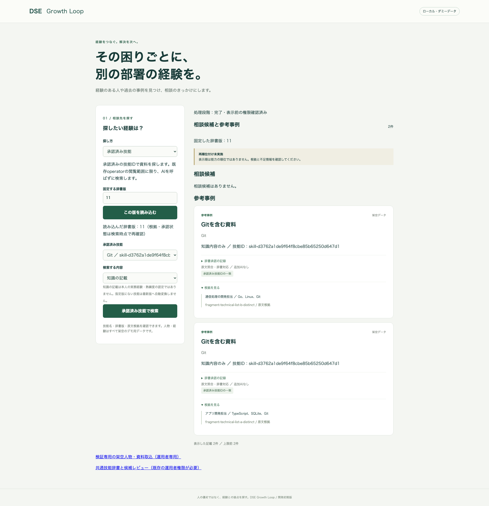

# 以前の架空資料を使った通常画面の技能ID検索

## 概要

2026-11-07 UTC、以前の架空2資料と個別化済みの保存応答fixtureを使い、辞書レビューから通常デモ画面 `validation.html` へ進み、承認済み技能IDで原文根拠を探す操作を実装・検証した。終始、架空データだけを使用した。実AI、Azure操作、権限変更、push・配備は0回。

先行する[隔離デモ](20261107-isolated-skill-document-demo.md)の専用画面だけでなく、通常デモ画面の検索モードとして利用できる。従来の語・分類・自然文検索と条件を混ぜる実装や、技能IDの検索投影への永続化は含まない。

## 一連の操作と結果

1. 辞書レビュー画面で、以前の個別化fixtureから6候補を収集する。TypeScript・SQLite・Git・Go・Linuxを5つのIDへ承認し、2資料目のGitを同じGit IDへ対応付ける。
2. 「この辞書版で資料を探す」から通常画面へ進む。指定した辞書版を読み込み、「承認済み技能」と「知識の記載／実務経験の候補」を選ぶ。
3. 結果カードで、固定した辞書版、技能ID、知識／経験の区分、原文引用、根拠ID、承認監査を確認する。

| 検索対象 | 通常画面の結果 |
|---|---|
| Git・知識 | 同じGit IDで2資料 |
| SQLite・知識 | 1資料、Linuxとは別ID |
| Linux・知識 | 1資料、SQLiteとは別ID |
| 実務経験の候補 | 元の技術列だけからは0件 |

今回のブラウザ実行では、他の既存辞書回帰と同じメモリ内のため辞書版11。単体試験を初期状態から独立実行した場合は版5である。これらのID・版は再現試験内の値で、共有環境の辞書を更新した結果ではない。



[通常検索の応答・監査](../../web/screenshots/20261107-112252-technical-id-review/ordinary-search.json)、[6候補のID対応](../../web/screenshots/20261107-112252-technical-id-review/mapping.json)、[旧SQLite/Gitの保留](../../web/screenshots/20261107-112245-technical-candidates/01-held-proposals.png)、[旧Linux/Gitの保留](../../web/screenshots/20261107-112245-technical-candidates/02-held-proposals.png)。旧4案は保留と原文を維持しており、検索のために書き換えていない。

## 設計と利用範囲

`POST /api/v1/skill-dictionary/search` を追加した。既存の `SkillDictionaryService` と現在の原文検証・固定版プレビューを再利用し、読み取り時に対応付ける。既存 `/api/search`・`/api/v2/search` の条件や検索投影を書き換えない。

- 既存operatorだけが利用可能。辞書の共有scopeと現在の原文閲覧条件を確認し、tenant fenceを応答直列化まで保持する。権限を広げない。
- 固定されるのは辞書版。認可・根拠・候補fingerprint・承認状態は検索時点の値を再確認し、古い辞書版を使っても撤回された引用は復元しない。
- 知識は `content_only`、経験候補は `eligible` の一致だけを返す。どちらも資料の記載として表示し、人物IDを作ったり、知識を本人経験・熟練度へ昇格させたりしない。
- 管理画面専用フラグ付きの候補、保留・未承認・更新済み根拠を通常検索へ混ぜない。この利用範囲の境界は、実データ／架空データの区別ではない。
- 統合前の辞書版では旧ID、統合後では新IDを使う。統合済み候補の根拠も承認済みの記載として照合し、inactiveな旧IDを最新版へ黙って変換しない。
- 辞書版・技能ID・区分はJSONでも必須。表示上限100件、走査100ページ（1ページ50件）。閲覧結果が空のページも数え、上限超過は422で部分成功を返さない。既存の検索RU予算も使う。
- 検索自体はAI呼出し・再収集・辞書変更・投影更新・承認監査の追記を行わない。版・条件変更やモード切替で古い結果を消し、後から届いた旧応答も表示しない。

画面fixtureの構成では検索と関係のない取込・会話・プロフィールパネルを起動しない。通常の構成ではこれらの既存パネルを維持する。テスト用operatorを共有環境へ追加する変更はない。

## 検証

| 対象 | 結果 |
|---|---|
| 新規検索テスト | 12成功。固定版、知識／経験、現在の認可・撤回・原文更新、件数上限、読取専用、ページング、統合後の旧版、版省略拒否を確認 |
| .NET全回帰 | 1,237成功、失敗・skipなし |
| 辞書ブラウザ | 9成功、失敗・skipなし、16.2秒。承認→通常画面→3技能検索、実HTTPの版省略400・権限403、遅延応答破棄まで確認 |
| 従来検索ブラウザ | 16成功、失敗・skipなし。語・自然文・種別・対象外・エラー時の表示を確認 |
| 契約 | 41成功。新ルート、明示版必須、読取専用、実際の通常検索応答をOpenAPIで検証 |
| 認証 | 9成功 |
| Web型検査・build | 成功 |
| 新検索処理のカバレッジ | `SkillDictionarySearch.cs` の行33/33・分岐14/14。入力型や他の既存コード全体の率ではない |

TDDでは、未実装サービスと画面導線、null入力・空ページ走査、統合後の旧版検索、JSONの版省略についてREDを実行してから修正し、同じ対象をGREENにした。途中のテスト作成では、承認済み候補をdeferへ変更できると誤って仮定した。既存の `SKILL_ALREADY_REVIEWED` 拒否を維持し、その拒否と原文アクセス版の変更を検査する形へ直した。製品の再承認制限は緩めていない。

契約検査の初回は選んだPython環境にjsonschemaがなく起動できなかった。既存の契約検査環境 `/tmp/dse-pr68-contract-env` を使い、全件成功を確認した。パッケージの追加取得はしていない。

再現コマンド（リポジトリルート）:

```sh
dotnet test tests/Dse.Tests --no-restore
npm --prefix web run test:e2e:dictionary
```

通常検索だけのブラウザ回帰は `web/` で `npx playwright test tests/search.spec.ts`。いずれも既存のMock・loopback・メモリ構成を使い、検証終了後にサーバーを終了する。アプリのコードで新しい有料推論を許可する操作はない。

## 残課題と保存状況

通常デモ画面での技能ID検索は接続済み。未対応なのは、語・分類との複合条件、自然文AIによる技能ID選択や再順位付け、技能IDの永続検索投影である。今回は以前の架空2資料と保存応答で手続きを検証したもので、新しい実AI抽出精度を測定した結果ではない。今後の統合試験も架空データで進められる。

変更はローカルブランチ `feature/32-isolated-skill-document-demo` に保存。共有辞書・データ・IAMは変更せず、push・PR作成・配備は未実施。既存の未追跡 `preflight-report.md` は保持した。
