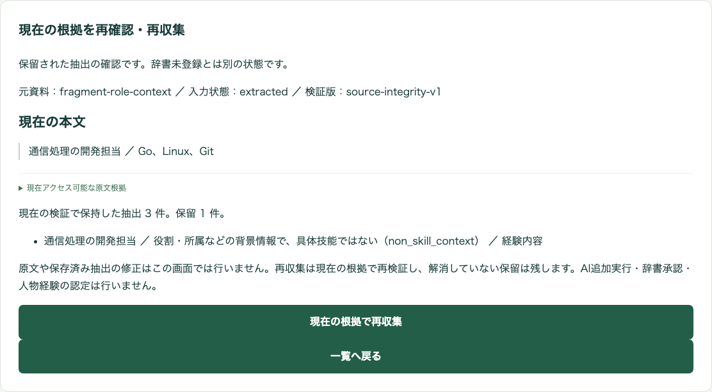

# 役割表現の技能検索への混入を抑止した回帰検証

## 概要

2026-11-07 UTC、[前回の実AI検証](20261107-pr68-live-technical-lists.md)で発生した「通信処理の開発担当」の経験検索語への昇格を、保存済み合成応答で再現し、ローカルで修正した。追加の有料推論、IAM変更、Azure書込み、本番マージ・配備は行っていない。新版プロンプトの実AI品質を確認した結果ではない。

## 原因と変更範囲

引用が原文に一致し、AIが `basis=experience` を返すと、人物の投影時に `sourceKind=person` として再評価され、役割名も `eligible` になっていた。直接AiServiceを呼んだ際の主体未解決・検索語なしという結果だけでは、この昇格を検出できない。

新しい抽出契約は `contentKind` を要求する。具体作業の記述は `skill_statement`、独立した技術列の項目は `technology_list`、役割・所属・見出しなどは `context`、未確定は `uncertain` とする。AIへの指示で背景情報を技能から除くよう明記し、サーバーは各項目に `contextPolicy=skill-context-v1` を付ける。AIがこのポリシーを指定することはできない。

- `context` は `non_skill_context` として保留する。
- 文脈種別がない経験候補、未確定・未知の種別は `skill_context_unverified` として保留する。記録済み旧応答の知識項目は保持するが、経験にはしない。
- 技術列を経験とする矛盾は `skill_context_conflict` として保留する。
- ポリシーを項目ごとに保存し、人物全体への結合・再投影・再収集でも保留項目を復活させない。
- プロンプトは通常文書 `specific-skills-context-v5`、セル参照 `specific-skills-cell-v4` に更新し、旧抽出キャッシュを新規抽出へ流用しない。保存データ版とセル全文引用契約は維持する。
- 既存の旧版レコードを一括書換え・再分類しない。本人訂正は再取込で上書きせず、競合と抽出案を保持する。

役割名に含まれる単語の決め打ち除外や、コードによる文の分割・書換えは追加していない。「担当者と共同で通信処理の単体試験を実施した。」のような具体作業は、正しい文脈種別があれば経験候補として保持する。本人による確認済みの経験を認定する処理ではない。

## 実際に検証した経路

[記録済み応答](../../tests/Dse.Tests/Fixtures/pr68-technical-list-captured.json)は、前回の2件の解析結果を使用した。原文・raw・正規化案・basisを保持し、根拠IDだけを隔離テスト用に対応付けた。新しい種別を捏造して旧応答を合格にしたのではなく、種別を欠く余分な経験候補が保留されることを確認した。

| 範囲 | 結果 |
| --- | --- |
| 合成2件 × DOCX/XLSX | 4件とも取込サービス → ローカル永続Queue → 常用Workerと同じ `IngestionProcessor` の取込・enrichment処理 → 投影・コミット → SourceGuard → 検索まで成功 |
| 各技術列 | 3件のknowledgeを保持。2資料で6記載、5種類。本人の経験検索語は空 |
| 余分な役割名 | 2件目で `skill_context_unverified` 保留。具体技能検索では人物に一致しない |
| 通常の本文検索 | 原文を検索可能なまま保持。役割名を `SpecificSkillMatches` に数えない |
| 再投影・本人訂正後の再取込 | 不要な再抽出なし。保留維持。本人訂正文を保持し、競合・pendingExtractionを記録 |
| AiServiceの通常文書・セル参照契約 | 新スキーマ、引用復元、サーバーポリシー、種別あり／なしと正しい知識の同時保持を確認。外部HTTPはテストダブル |
| 通常の辞書画面と製品API | 保留理由、知識3件＋役割保留1件、再収集で新規0件、役割の承認画面なし、辞書の不変を確認 |
| 既存の技術候補4件の画面回帰 | 未承認のSQLite/Git・Linux/Git案の表示・保留維持が成功。隔離メモリ内の別資料で6知識を5技能IDへ対応し、Gitの共有IDとcontent_onlyを確認 |

画面試験は既存のループバック専用メモリホストと架空の確認者を使った。共有環境の利用者権限を拡大していない。外部AI呼出しは0回。画面試験の終了後、5175/5182に待受プロセスがないことを確認した。

## テストと再現方法

修正前に回帰テストを実行し、ドメイン・投影の9件中5件、要求スキーマの2件中2件の失敗を確認してコミットした。修正後は次を実行した。

- `dotnet test tests/Dse.Tests --no-restore --filter 'FullyQualifiedName~SkillContextRegressionTests|FullyQualifiedName~Current_skill_request_requires_context'`: 18件成功。
- `dotnet test tests/Dse.Tests --no-restore`: 1,223件成功、失敗・スキップ0件。
- `npm run build`（web）: TypeScript・Vite成功。
- 既存の `playwright.skill-dictionary.config.ts` にheadless、1920×1080、隔離成果物先のみを指定した実行: 9件成功。
- `git diff --check`: 成功。

追加回帰の実装は [SkillContextRegressionTests](../../tests/Dse.Tests/SkillContextRegressionTests.cs)、[AiSkillContextContractTests](../../tests/Dse.Tests/AiSkillContextContractTests.cs)、[画面テスト](../../web/tests/skill-dictionary.spec.ts)。集計は [JSON記録](data/20261107-role-context-regression.json)。詳細ログは作業領域の `evidence/role-context-fix-20261107/` に保存した。

## 未検証とPRへの反映

新版の文脈分類を実モデルが正しく返すかは未検証。モデルが役割名を誤って `skill_statement` と判定する可能性は残り、意味品質を機械的に保証する修正ではない。既存の有料推論承認枠は2回とも消費済みのため、追加推論を行っていない。

Azure Queue・常用Worker・Azure認証付き承認・共有辞書への反映、公開プレビュー上の新版実装は今回未検証。ローカルQueueと専用テストホストの成功を、通常Azure経路の成功に置き換えない。既存の実環境の保留4件や辞書・本人データも変更していない。

[Draft PR #68](https://github.com/kokutaro/dse-growth-loop/pull/68)は読み取り照会時にOPEN/Draft、remote headは `c92a9a51a485f1237178d50e96a83e135618ca99` のまま。製品修正は `79cd277`、最終追加回帰は `d4a59bb` として同じブランチにローカル保存した。pushは行っていない。`preview-build.yml` のsynchronizeから `cd-preview.yml` が自動配信される構成のため、pushによるAzure再配備は追加費用・追加配備をしない今回の範囲を超える。workflowの停止・設定変更も行っていない。
