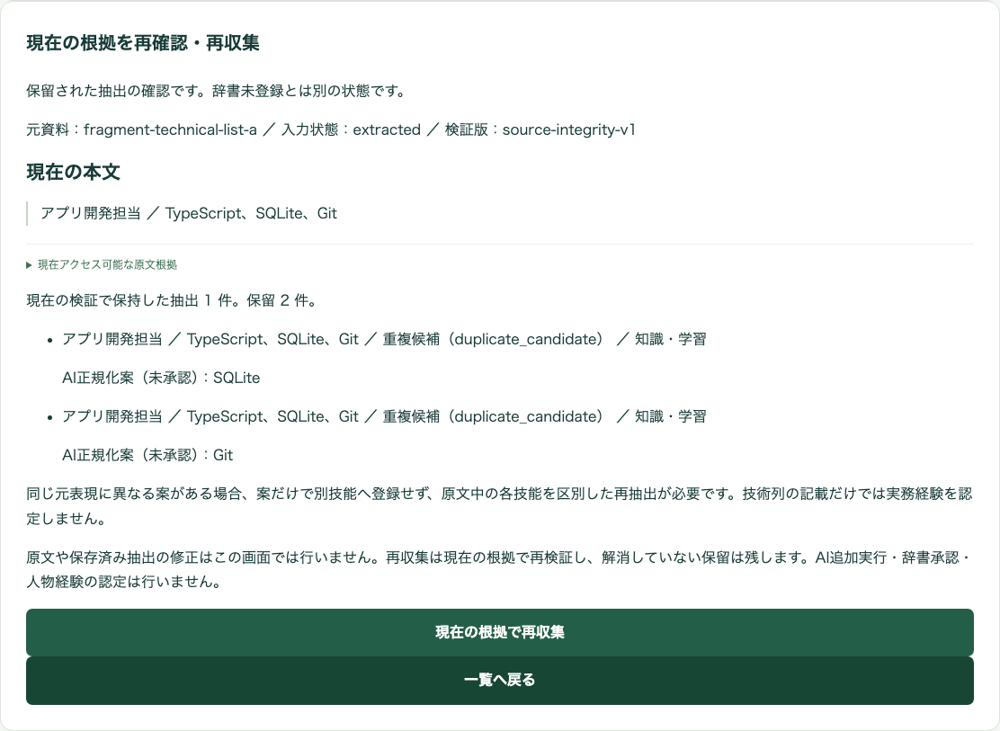

# 技術候補4件と技能ID対応の再試行

## 概要

追記: 05:09 UTCに別承認の実AI2件を実行した。期待技術6記載の個別化は成功したが、役割表現の追加により厳密評価は1成功・1不合格だった。[実AI結果と権限削除の記録](20261107-pr68-live-technical-lists.md)を参照。以下は先行するMock・保存応答の検証記録である。

2026-11-07 UTC、PR #68のコードを使い、loopback専用メモリ環境で4案の未承認表示と辞書承認・ID対応を再試行した。既存7件と新規1件の画面E2Eは8件成功、関連API・ドメインテストは30件成功した。公開プレビューのoperator権限や本番データは変更していない。実AIを再送した結果ではない。

## 権限と検証環境

公開Mockの3利用者にoperatorがないことは、既存の権限設計どおりである。既存の `Dse.SkillDictionaryBrowserHost` は127.0.0.1だけで待受け、専用MemoryRecordStore内のfixture-curatorを使用する。Azure認証・本番の権限設定・実AIには接続しない。今回はこの環境で権限問題を回避せず、正規のoperator処理を検証した。

既存E2Eでは非operatorの403、範囲外の空集合、根拠撤回後の表示停止、同じ操作の再送、辞書の古い版からの承認拒否も成功した。これはAzure JWT認証の再検証ではない。

## 4案とID対応

元の保留データは変更しない。SQLite/GitおよびLinux/Gitの4案は、保留画面で「AI正規化案（未承認）」として表示され、承認画面へ直結しないことを再確認した。

追加したテストは、独立した技術語をrawにした**保存応答fixture**を別資料として用いる。実モデルがその応答を生成したと主張しない。個別化済みの入力について、原文全文とknowledge種別を確認し、UIから5件の新規承認と2資料目Gitの既存IDへの別名承認を実行した。同じ別名の再確認では辞書版を増やさず、承認履歴は記録する。

| 技術列の原文 | 個別の知識候補 | 対応 |
| --- | --- | --- |
| アプリ開発担当 ／ TypeScript、SQLite、Git | TypeScript / SQLite / Git | それぞれ別の承認済み技能ID |
| 通信処理の開発担当 ／ Go、Linux、Git | Go / Linux / Git | Go・Linuxは別ID、Gitは上段と同じID |

全6候補の固定版プレビューで `content_only` を保持し、業務レコード・goldは変更しない。辞書承認を本人の経験認定や本番検索への反映と同一視しない。既存シナリオの登録・別名・統合、旧IDのredirectと過去版保持も成功した。



[LinuxとGitの未承認表示](../../web/screenshots/20261107-035840-technical-candidates/02-held-proposals.png)、[6候補のID対応画面](../../web/screenshots/20261107-035847-technical-id-review/01-knowledge-id-mapping.png)、[今回のメモリ内ID記録](../../web/screenshots/20261107-035847-technical-id-review/mapping.json)。これらのIDは使い捨てのテストIDである。

## 再試行結果

| 対象 | 結果 |
| --- | --- |
| 画面E2E | 8成功、失敗・skip・flakyなし。2026-11-07 03:58:37 UTC開始、11.7秒 |
| 関連API・ドメイン | 30成功、失敗・skipなし |
| 外部AI呼出し | 0 |
| 共有環境の設定・権限・データ変更 | 0 |
| 本番マージ・配備 | 0 |

対象API・ドメインの再現コマンド:

```sh
dotnet test tests/Dse.Tests --no-build --no-restore --filter 'FullyQualifiedName~TechnicalCandidateReviewTests|FullyQualifiedName~SkillDictionary|FullyQualifiedName~SkillSourceReview|FullyQualifiedName~SpecificSkill|FullyQualifiedName~SkillChoiceProductTests'
```

画面E2Eは既存 `web/playwright.skill-dictionary.config.ts` の専用ホストを使い、headless・1920×1080、出力先のみ実行用configで指定した。各テストサーバーとブラウザは終了済み。

## 実AI再試行に必要な追加範囲

前回承認は既存合成Cの新世代1回・最大7呼出しに限定され、その7回は配備済みmain/cell-v2で消費済みである。今回の「追加費用を実施しない」範囲では、新しいPR68/cell-v3の有料呼出しに流用しない。

小さい追加検証案は、ローカルMemoryRecordStoreで上記2資料を `specific-skills-cell-v3` に各1回送る方法である。対象は既存Foundry `dse-foundry-ypbunss3xh66m` / deployment `dse-luna6-eval` / model `gpt-6-luna-2026-09-22`。Jevは使わない。各入力上限10,240・出力上限4,096 tokens、最大2回、再試行なし。現設定単価 `$0.20 / $1.20 per million` では上限参考額は **$0.0139264**。実請求の保証ではない。

本人の対象スコープの割当を読取照会したところ、OwnerとAzure Cosmos DB Control Plane Ownerのみで、Foundry推論用ロールは見つからなかった。OwnerだけではEntra推論アクセスを与えない。[Microsoft公式説明](https://learn.microsoft.com/en-us/azure/ai-foundry/foundry-models/how-to/configure-entra-id)

このコンピューターから実行するなら、既存の推論権限付き検証主体を使うか、現在のログインへ対象Foundryアカウントだけの `Cognitive Services OpenAI User` を明示承認の上で追加する必要がある。後者はこの2回に限らずアカウント内OpenAI配備への推論を許すため、期間と削除方針を含めた別承認が必要。ロール付与・キー取得・実AI呼出しはいずれも未実施。[最小権限の公式案内](https://learn.microsoft.com/en-us/azure/developer/ai/keyless-connections)

この2回の検証は技術列抽出の品質確認であり、通常の新規取込・Azure Queue・常用Worker・本番の技能承認を含む一貫テストの代わりにはならない。

## 配信への影響

変更は試験ホスト・E2E・検証記録だけで、製品の権限・抽出・辞書処理は変更していない。PRへのpushはsynchronize→preview-build→preview配信を起動し得るため、追加配備・費用を生じさせない今回の範囲では行わない。公開プレビューへoperatorや試験専用seed APIを追加しない。
